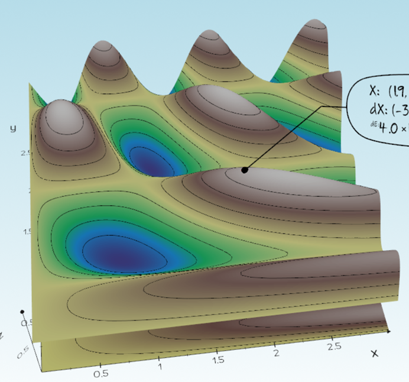
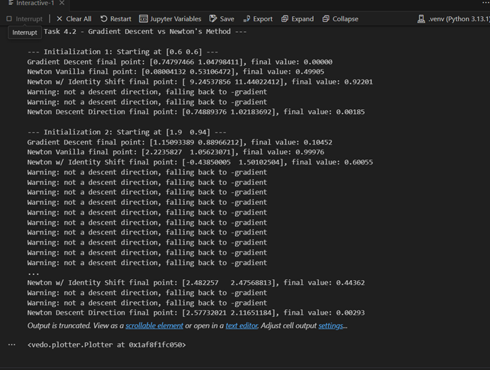

# Optimization Visualizer – Gradient Descent vs. Newton's Method

An interactive 3D tool in **Python** for exploring how numerical optimization methods find the minimum of a function. Pick a starting point on a 3D surface and watch **gradient descent** and **Newton's method** travel downhill side by side.

Built for the **Introduction to Animation and Robotics** course at the University of Haifa (2025).

  
  

## Features

**Interactive exploration**
- Right-click on the surface to choose a starting point
- Switch between objective functions with keys **1–3**
- Live 2D plot of the function value along each optimization path

**Optimization methods**
- **Gradient descent**
- **Newton's method** using the Hessian, with two safer variants:
  - *Identity shift* – keeps the Hessian positive-definite
  - *Descent check* – falls back to the gradient direction when the Newton step would go uphill
- **Backtracking line search** (Armijo condition) for stable step sizes
- **Automatic stopping** when the gradient norm drops below a tolerance
- **Numerical derivatives** (finite differences) compared with the analytic ones

**Experiments**
- Compared all methods from several starting points: plain Newton fails where the Hessian is not positive-definite, while the descent-check variant was the most robust

## Documentation

- [`report.md`](report.md) – full write-up with screenshots, results, and analysis
- [`assignment_instructions.md`](assignment_instructions.md) – the original assignment instructions

## Running

    pip install vedo numpy
    python Assignment1.py

## Tech Stack

Python · NumPy · vedo (interactive 3D visualization)

---

Developed by **Hala Ishan** · Introduction to Animation and Robotics, University of Haifa
