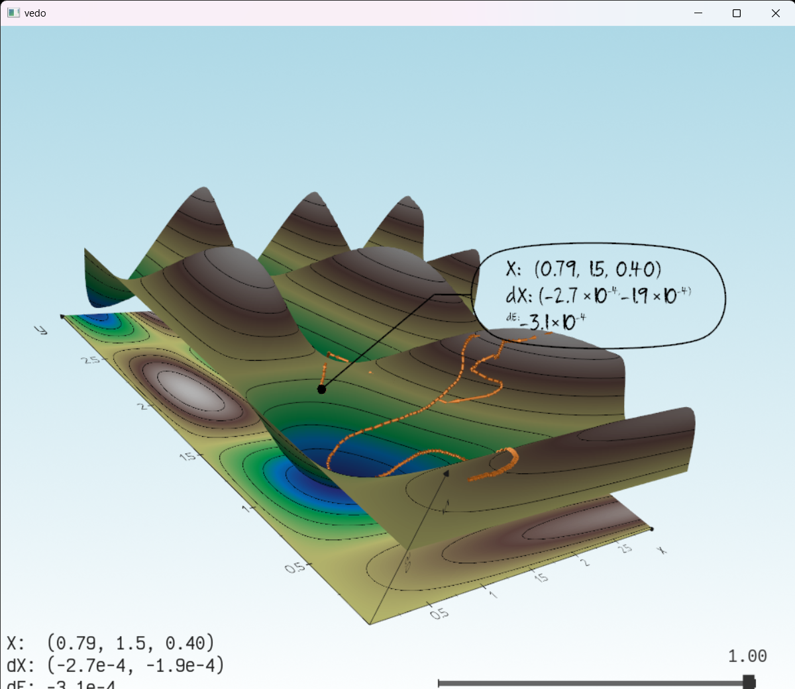
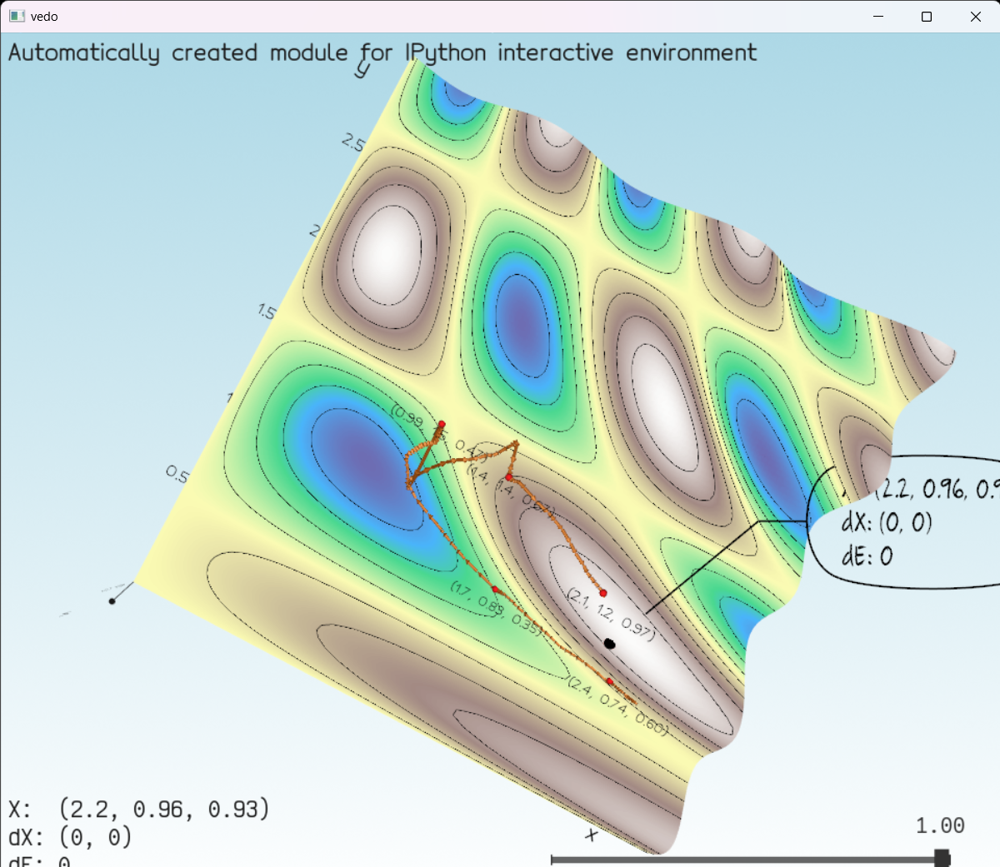
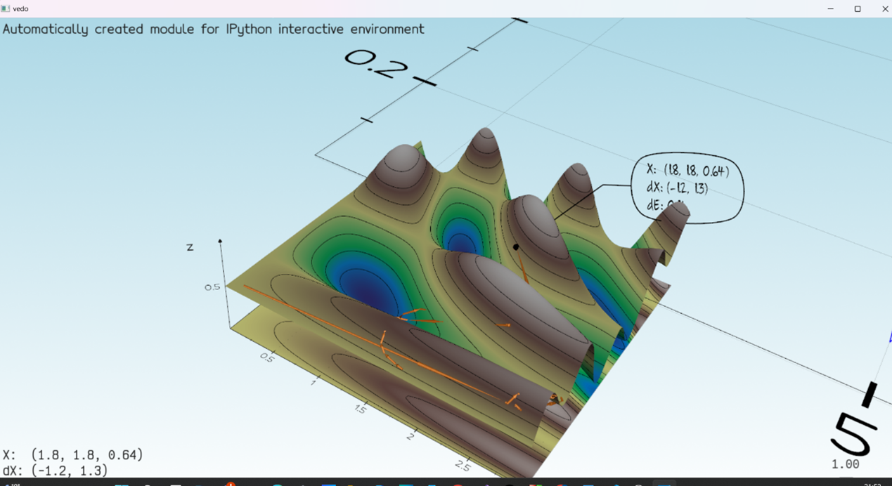
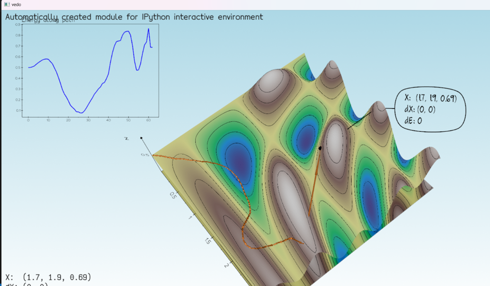
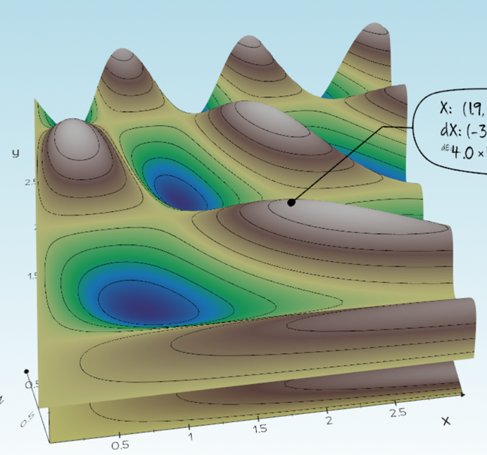
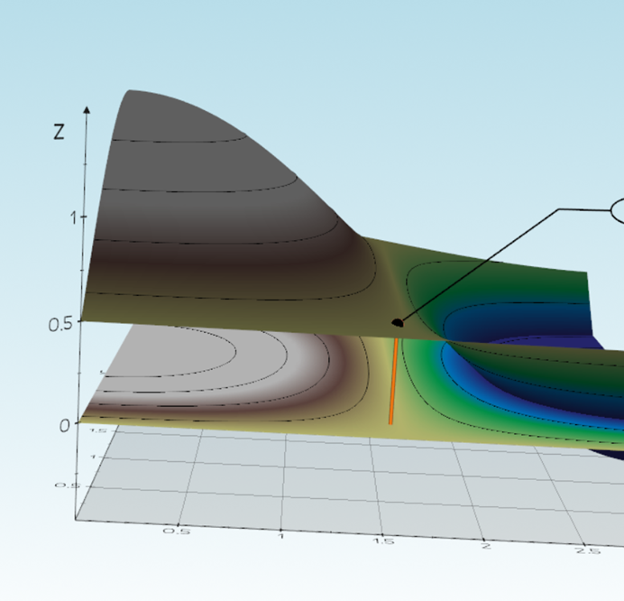
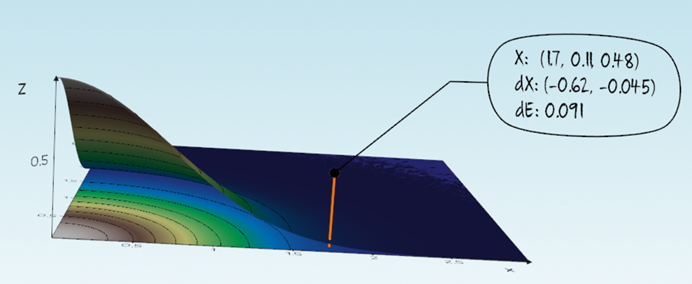

# Report for Assignment 1

**Name:** Hala Ishan  
**Student ID:** 213692296

# GUI Exploration – Before Starting Tasks

Before beginning the tasks, I explored the interactive GUI created by the `vedo` package in the assignment.

## 🔄 Interaction Summary

- 🖱️ **Mouse Movement**:  
  Hovering the mouse over the 3D surface dynamically created a path, showing sampled points.

- 🏷️ **Text Flag & Info Panel**:  
  - A **floating flag** appears next to the mouse path, showing the 3D coordinate and related values.  
  - The **bottom-left text area** displayed:
    - `X`: The selected point
    - `dX`: Distance between current and previous points
    - `dE`: Energy difference between the two

- 🔘 **Transparency Slider**:  
  A slider at the **bottom-right corner** adjusts the surface’s transparency in real time.

- ⌨️ **Keyboard – ‘c’ key**:  
  Pressing `c` resets/clears the entire path.

- 🎥 **Responsiveness**:  
  The GUI responds quickly and smoothly, allowing live interaction without restarting the script.

## 📸 Screenshot

Below is a screenshot showing the path, floating flag, and transparency slider:




---

# Task 1.1 – Right Mouse Click Callback

## 🎯 Goal
Add a mouse callback that responds to a **right-click**, allowing users to interact with the surface in a new way.

## 🛠️ Implementation
I created a function called `OnMousePress(evt)` that is triggered when the user right-clicks. The function uses `evt.picked3d` to get the 3D coordinates under the cursor, then adds:
- A red 3D sphere at the clicked point
- A 3D text label showing the coordinates

This callback is registered using:

```python
plt.add_callback("right button press", OnMousePress)

## 📸 Screenshot

Below is a screenshot showing the a red 3D sphere at the clicked pointand a text label showing the coordinates:



## 🎥 Video Demonstration

[▶ Click to watch the Task 1.1 demo video](videos/task1.1_demo.mkv)

note : when i press c i delete all the point and their labels
[▶ Click to watch the Task 1.1 demo2 - press 'c' to clear](videos/task1.1_vedio2.mkv)


---
Task 1.2 – Visualizing Function Values on the Path
🎯 Goal
Display the energy values along the path traced by the mouse (Xi) as a live-updating graph, using vedo.plot.

❌ First Attempt – Using plot() Alone
Initially, I used the plot() function from vedo directly. This successfully generated the graph, but it was embedded inside the 3D world, which made it very difficult to interpret. The graph moved with the camera, was often obscured by the surface, and lost its readability.

Below is an image showing the result of this initial approach:



🧪 Fix Attempts (Still Without clone2d())
I tried improving the graph visibility using several methods, including:

📍 Repositioning it using .pos(2, -2, 1) to move it out of the main surface area

🧊 Adjusting transparency of the surface with .alpha(0.3) to avoid occlusion

🎨 Changing line color and width for contrast (lc='blue', lw=3)

⚠️ Attempting to rotate the plot with .rotateX() — which failed, since PlotXY objects do not support rotation and raised an error

Despite repositioning, the graph remained locked in the 3D space and subject to perspective distortion:


✅ Final Fix – Using clone2d()
To fully solve the issue, I applied clone2d() to the plot object. This transformed the graph into a 2D overlay, anchored to the screen rather than the 3D scene. As a result, the graph:

📌 Remains visible regardless of camera orientation

🎯 Provides a consistent and reliable visualization

👁️‍🗨️ Enhances user experience during interaction

Below is the improved result using clone2d():



[▶ Or embed a video if needed:](videos/task1.2_demo.mkv)

---

Task 1.3 – Changing the Objective Function via the GUI
🎯 Goal
Allow the user to switch between different objective functions dynamically using the GUI.

✅ Implementation Summary
I extended the interactive system by allowing function switching using keyboard keys:

Press 1 to view the Wavy Sine-Cosine function (default).

Press 2 to view the Ripple Pattern.

Press 3 to view the Gaussian Hill.


This interaction is handled in the OnKeyPress callback:
When the user presses 1, 2, or 3, the global variable current_function is updated accordingly.
Then, the helper function reset_surface_plot() is called to:
Clear the existing plot (fplt3d and fplt2d)
Clear the energy graph if present
Reset the user-drawn path
Re-render the surface using the new function.

✨ Why This Approach?
Instead of using GUI widgets like buttons (which aren't fully supported in vedo's current version), I implemented keyboard-based control. This method is:

Intuitive: Simple key presses control function changes
Effective: Clears the path and energy plot automatically
Clean: Keeps the interface visually minimal

🧪 Challenges
I initially attempted to use add_button_radio() from vedo, but this method wasn’t available in the current version. As a fallback, I used key bindings, which ended up working more smoothly for our use case.
[▶ vedio1:](videos/task1.3_demo1.mkv)


Task 2.1 – Gradient Descent Interaction
In this task, the goal was to disable mouse-based path creation and prepare the environment for interactive gradient descent. Instead of deleting the existing path-related code, I introduced a global toggle variable enable_mouse_path and updated the OnMouseMove callback to respect it. By setting enable_mouse_path = False, the mouse still shows coordinates and updates text and flag visuals, but no longer appends to the path Xi. This approach preserves the infrastructure for plotting the optimization path later, as required for Task 2.2.

[▶ Watch Task 2.1 Video:](videos/task2.1_demo.mkv)
