# Report for Assignment 1

**Name:** Hala Ishan  
**Student ID:** 213692296

# GUI Exploration – Before Starting Tasks

Before beginning the tasks, I explored the interactive GUI created by the `vedo` package in the assignment.

## 🔄 Interaction Summary

- 🖱️ **Mouse Movement**:  
  Hovering the mouse over the 3D surface dynamically created a path, showing sampled points.

- 🏷️ **Text Flag & Info Panel**:  
  - A **floating flag** appears next to the mouse path, showing the 3D coordinate and related values.  
  - The **bottom-left text area** displayed:
    - `X`: The selected point
    - `dX`: Distance between current and previous points
    - `dE`: Energy difference between the two

- 🔘 **Transparency Slider**:  
  A slider at the **bottom-right corner** adjusts the surface’s transparency in real time.

- ⌨️ **Keyboard – ‘c’ key**:  
  Pressing `c` resets/clears the entire path.

- 🎥 **Responsiveness**:  
  The GUI responds quickly and smoothly, allowing live interaction without restarting the script.

## 📸 Screenshot

Below is a screenshot showing the path, floating flag, and transparency slider:

### Task 1: Understand the code

# Task 1.1 – Right Mouse Click Callback

## 🎯 Goal
Add a mouse callback that responds to a **right-click**, allowing users to interact with the surface in a new way.

## 🛠️ Implementation
I created a function called `OnMousePress(evt)` that is triggered when the user right-clicks. The function uses `evt.picked3d` to get the 3D coordinates under the cursor, then adds:
- A red 3D sphere at the clicked point
- A 3D text label showing the coordinates

This callback is registered using:

plt.add_callback("right button press", OnMousePress)

## 📸 Screenshot

Below is a screenshot showing the a red 3D sphere at the clicked pointand a text label showing the coordinates:

## 🎥 Video Demonstration

[▶ Click to watch the Task 1.1 demo video](videos/task1.1_demo.mkv)

note : when i press c i delete all the point and their labels
[▶ Click to watch the Task 1.1 demo2 - press 'c' to clear](videos/task1.1_vedio2.mkv)

Task 1.2 – Visualizing Function Values on the Path
🎯 Goal
Display the energy values along the path traced by the mouse (Xi) as a live-updating graph, using vedo.plot.

❌ First Attempt – Using plot() Alone
Initially, I used the plot() function from vedo directly. This successfully generated the graph, but it was embedded inside the 3D world, which made it very difficult to interpret. The graph moved with the camera, was often obscured by the surface, and lost its readability.

Below is an image showing the result of this initial approach:

🧪 Fix Attempts (Still Without clone2d())
I tried improving the graph visibility using several methods, including:

📍 Repositioning it using .pos(2, -2, 1) to move it out of the main surface area

🧊 Adjusting transparency of the surface with .alpha(0.3) to avoid occlusion

🎨 Changing line color and width for contrast (lc='blue', lw=3)

⚠️ Attempting to rotate the plot with .rotateX() — which failed, since PlotXY objects do not support rotation and raised an error

Despite repositioning, the graph remained locked in the 3D space and subject to perspective distortion:

✅ Final Fix – Using clone2d()
To fully solve the issue, I applied clone2d() to the plot object. This transformed the graph into a 2D overlay, anchored to the screen rather than the 3D scene. As a result, the graph:

📌 Remains visible regardless of camera orientation

🎯 Provides a consistent and reliable visualization

👁️‍🗨️ Enhances user experience during interaction

Below is the improved result using clone2d():

[▶ Or embed a video if needed:](videos/task1.2_demo.mkv)

Task 1.3 – Changing the Objective Function via the GUI
🎯 Goal
Allow the user to switch between different objective functions dynamically using the GUI.

✅ Implementation Summary
I extended the interactive system by allowing function switching using keyboard keys:

This interaction is handled in the OnKeyPress callback:
When the user presses 1, 2, or 3, the global variable current_function is updated accordingly.
Then, the helper function reset_surface_plot() is called to:
Clear the existing plot (fplt3d and fplt2d)
Clear the energy graph if present
Reset the user-drawn path
Re-render the surface using the new function.

✨ Why This Approach?
Instead of using GUI widgets like buttons (which aren't fully supported in vedo's current version), I implemented keyboard-based control. This method is:

Intuitive: Simple key presses control function changes
Effective: Clears the path and energy plot automatically
Clean: Keeps the interface visually minimal

🧪 Challenges
I initially attempted to use add_button_radio() from vedo, but this method wasn’t available in the current version. As a fallback, I used key bindings, which ended up working more smoothly for our use case.
[▶ vedio1:](videos/task1.3_demo1.mkv)

### Task 2: Gradient Descent

Task 2.1 –removing path
In this task, the goal was to disable mouse-based path creation and prepare the environment for interactive gradient descent. Instead of deleting the existing path-related code, I introduced a global toggle variable enable_mouse_path and updated the OnMouseMove callback to respect it. By setting enable_mouse_path = False, the mouse still shows coordinates and updates text and flag visuals, but no longer appends to the path Xi. This approach preserves the infrastructure for plotting the optimization path later, as required for Task 2.2.

[▶ Watch Task 2.1 Video:](videos/task2.1_demo.mkv)

that what i did at task 2.1 at first but after i contiue and almost finished i missed the code up but wanted to use another simplier and quicker way to do this task which is hidden the two lines of code that are responsible of creating the path as the mouse move 

[▶ Watch Task 2.1 Video:](videos/task2.1_demo2.mkv)

again i didnt notice that i hidden the coordinations (x,y,z) and add them again and corrected it but as it apears for me usung the last version is better so i restored the code and continue working on it

task 2.2 - Left Click – Set Initial Guess

I added a new callback OnMouseLeftPress(evt) for left mouse clicks. When the user clicks on the surface or plane below it:
The current path is cleared (Xi)
Any previous initial guess marker and label are removed
The clicked position is stored as the new initial guess (X0)
A black marker and 3D label are shown at the selected point with the label

In addition, pressing the ‘c’ key or switching the objective function via the GUI (keys 1, 2, or 3) also removes the initial guess marker and label

[▶ Watch Task 2.2 Video:](videos/task2.2_demo.mkv)

Task 2.3:
Implement a GUI that allows the user to trigger a fixed number of gradient descent steps (Task 2.3) using a button labeled “Run GD”.

[▶ Watch Task 2.3 Video:](videos/task2.3_demo.mkv)

[▶ Watch Task 2.3 Video2- changed num os steps:](videos/task2.3_demo2.mkv)

⚠️ Problem Encountered:
Despite wrapping the logic in an on_button_press() function and checking for event.action == "press", the button still triggered on mouse hover, or even immediately upon rendering, rather than waiting for a user click.
After several failed attempts to resolve this behavior via:
*Removing states
*Wrapping the button handler
*Inspecting event.action
I decided to replace the button with a keyboard shortcut.

🎯 Current Working Solution:
The user now activates gradient descent steps by pressing the key 'r' or 'R'. This avoids the hover-trigger issue entirely and ensures predictable behavior.
[▶ Watch Task 2.3 Video:](videos/task2.3_demo3.mkv)

[▶ Watch Task 2.3 Video2- changed number and step sizes:](videos/task2.3_demo4.mkv)

Step Size Experimentation (Task 2.3)
Goal:
Demonstrate how gradient descent behaves for different step sizes and identify an optimal value using the energy graph.
Optimal Step Size Selected: 0.1
After testing various step sizes, I found that:

step_size = 0.1 gives:
A stable and smooth convergence
The energy graph shows a gradual decrease with no oscillations
Reaches a good minimum within few steps

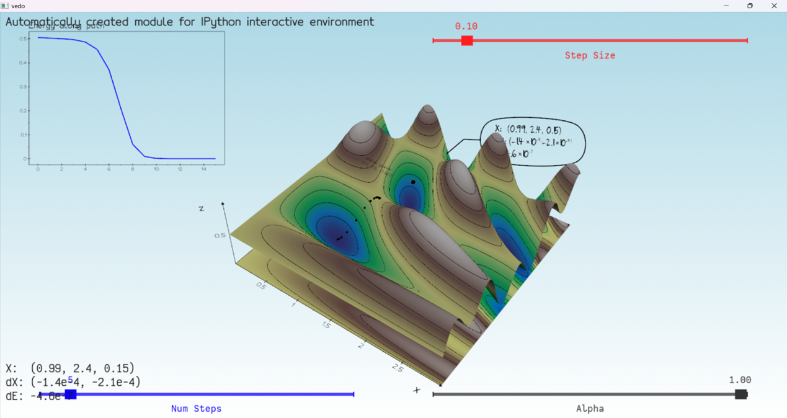
as it seems in the screenshot :
Smooth convergence in the energy plot.
Reaches the minimum in few steps.
No instability or oscillations.
Balanced and efficient.
so this is the optimal step size.

 i tested a lot of step sizes but two of them for comparison is :
Step Size = 0.01
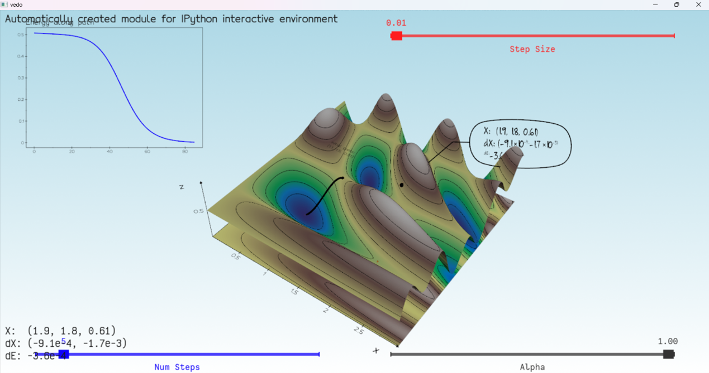
The energy plot shows very slow descent.
Although it eventually decreases, it takes many iterations to make noticeable progress.
dX and dE values are close to zero, meaning the algorithm is making tiny movements.
Visually, the path looks like it’s crawling toward the minimum.
⛔ Conclusion: Too small — stable but inefficient.

Step Size = 0.15
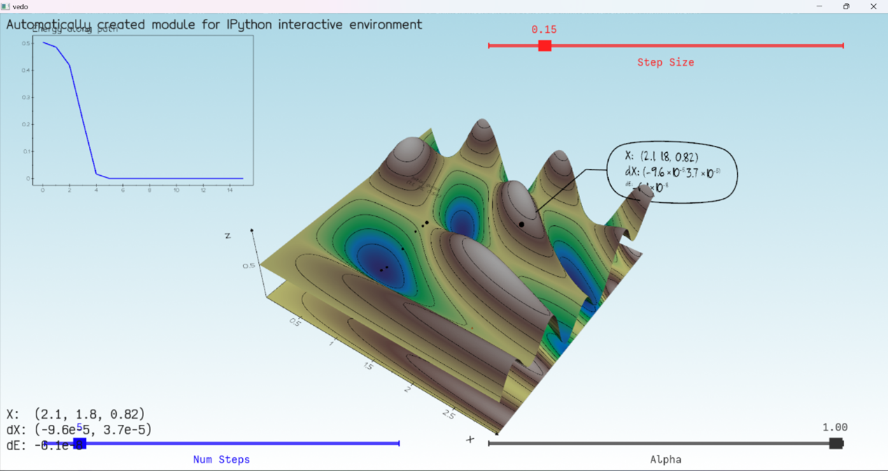
Appears to converge, but:
The path is less smooth.
Slight numerical instability in dX values (e+55 scale).
Energy curve drops quickly, but might overshoot in other cases.
Riskier, especially with more complex surfaces.
the more the step size is bigger it lead more to overshooting or unstable path

### Task 3: Newton's Method
Task 3.1: Comparing Newton's Method and Gradient Descent
In this task, I modified the code to simultaneously track two optimization paths:
One for Gradient Descent (black dots).
One for Newton's Method (orange dots).

Pressing the ‘r’ key now runs both methods from the same initial point and displays their paths on the 3D surface.
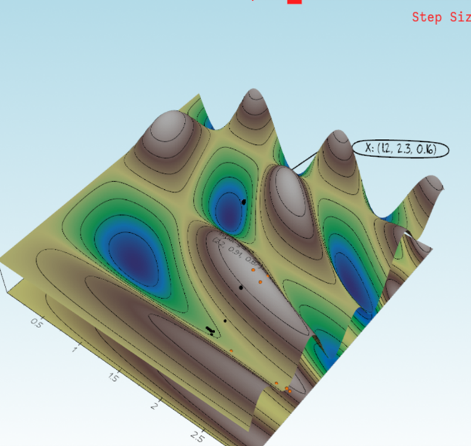

Task 3.2: Energy Comparison Between Gradient Descent and Newton’s Method
In this task, I extended the 2D energy plot (top-left corner) to display both the gradient descent and Newton’s method paths. The purpose is to compare the energy values (i.e., objective function outputs) along each method’s optimization trajectory.
🔧 Implementation Details:
I modified the update_energy_plot() function to check the length of both Xi (gradient descent path) and Xi_newton (Newton's path). (later refactor the name to Yi)
For each path, I computed the energy at every step and plotted it 
To ensure the plots were compatible, I used like=plot_gd when generating the Newton plot, matching the y-axis scaling.

The Newton energy curve was plotted in orange, and the gradient descent curve in black.
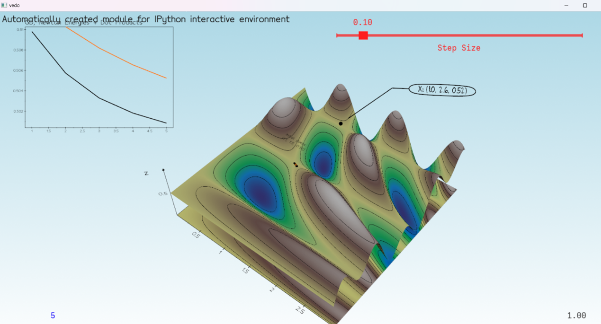

note:after i finish this task i forget to do push to github.

Task 3.3 – Plot Energies and Dot Products in a Unified Graph
🎯 Goal
Extend the energy plot to display not only the energy values for both optimization methods (Gradient Descent and Newton), but also include the dot product between the Newton direction and gradient vector at each iteration. This gives deeper insight into the optimization behavior.

❌ Initial Struggles
This task turned out to be the most challenging part of the assignment for me. I faced major debugging issues when trying to add the dot product values to the plot. Specifically:
The graph sometimes failed to update.
It threw shape errors when plotting the third curve.
Occasionally, the rendering of the plot crashed or showed nothing.
Dot products plotted at the wrong axis range or caused y-scaling mismatches.
I spent several hours trying to understand the issue, including:
Verifying the array shapes manually
Trying multiple plotting orders
Re-cloning the figure in different orders
Switching between different names and variables

⚠️ Eventually, I realized the underlying problem was related to plot object compatibility and incorrect figure referencing across multiple updates. After trying multiple minor fixes, I finally gave up and decided to rebuild the plotting logic from scratch.

🔁 Full Code Rewrite
I rewrote the entire energy plotting section and related function:
Re-created a new function from scratch, named update_2d_graph()
Used three separate plot() calls and linked them using like=...
Carefully synchronized x-axis indexes across:
Gradient Descent energy values (black)
Newton energy values (orange)
Dot products (green)
Used .clone2d() to create a clean overlay that always stays on screen
Updated the global state cleanup (pressing ‘c’ or changing function) to reset all three plots

✅ Final Result
After this overhaul, the energy + dot product graph works smoothly. It shows:
Gradual energy drop for both methods
How the dot product evolves during optimization
Clean comparison between methods

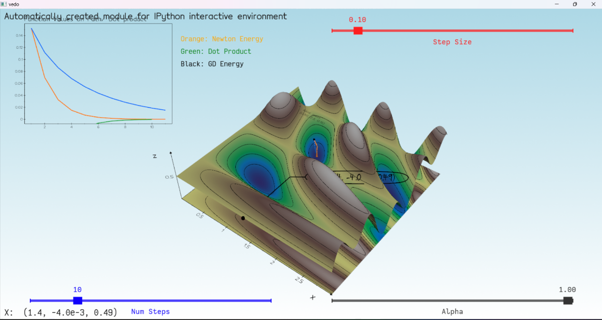

[▶ Task 3.3 – Full Demo Video:](videos/task3.3_demo.mkv)

Task 3.4 – Effect of Initial Point: Minimum vs. Saddle Point vs. Maximum
🎯 Goal
Investigate and compare how the behavior of optimization methods (Gradient Descent and Newton’s Method) changes based on where the initial guess is placed:
*Near a minimum
*Near a saddle point
*Near a maximum

🟢 Case 1 – Initial Point Near a Minimum
📍 Initial Guess: (1.9, 2.5, 0.54)
This point lies near a valley in the function landscape.
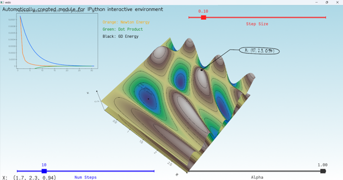
✅ Observation:
Both methods smoothly converge toward the minimum.
The energy values consistently decrease (black for GD, orange for Newton).
The dot product (green) is small, indicating the search directions align well.

🟡 Case 2 – Initial Point Near a Saddle Point
📍 Initial Guess: (1.7, 2.3, 0.94)
A saddle point is a flat region where one direction curves upward and the other curves downward.

⚠️ Observation:
Gradient Descent still manages to decrease the energy.
Newton’s method behaves differently: it may initially move in an unexpected direction due to the second-order nature of the Hessian.
The energy curves decrease but show more curvature compared to the minimum case.

🔴 Case 3 – Initial Point Near a Maximum
📍 Initial Guess: (0.4, 0.58, 1.0)
This point lies on a peak of the surface.
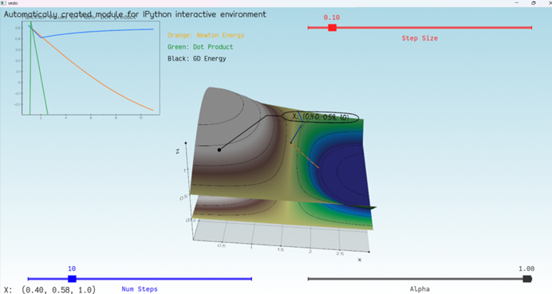

⛔ Observation:
Gradient Descent behaves poorly, barely descending.
Newton’s Method can attempt a steep move, but due to positive curvature (Hessian has positive eigenvalues), the update direction might not point toward a descent.
The dot product spikes sharply, showing disagreement between gradient and Newton directions.

🧠 Conclusion
The starting point has a critical influence on convergence:

Near minima: both methods perform well and predictably.
Near saddle points: methods work but show slower or less consistent descent.
Near maxima: both methods struggle, especially gradient descent.
Newton’s method is more sensitive to curvature and can misbehave in poorly conditioned regions, especially without damping or line search.

Task 4: Evaluate Optimization Methods
In this task, we aim to enhance the optimization system by comparing methods based on their convergence behavior and execution stability. A crucial step in this direction involves implementing a more adaptive step-size strategy rather than using a fixed step size.

✅ Line Search Implementation
To improve convergence and stability, I implemented a Backtracking Line Search using the Armijo condition:

def line_search(func, X, d, alpha=1.0):
    """
    Backtracking line search using Armijo condition.
    """
    rho = 0.5            # shrink factor
    c = 1e-4             # Armijo parameter
    f0 = func(X)
    grad = gradient_fd(func, X)

    while func(X + alpha * d) > f0 + c * alpha * np.dot(grad, d):
        alpha *= rho
        if alpha < 1e-8:  # safeguard
            break

    return alpha

💡 Why Armijo Line Search?
Using a fixed step size often leads to:
Overshooting near steep gradients
Slow convergence near minima
Instability around saddle points or flat regions
Instead, Armijo-based line search:
Adjusts the step size dynamically
Ensures sufficient decrease in function value at each step
Provides better stability and convergence guarantees

🧪 Experiment Summary
I integrated this into the optimization flow and observed that:
Gradient Descent became more stable across all test functions
Convergence paths were smoother and less prone to oscillations
The step size naturally shrank when approaching local minima

i have not much time , i finished task 5 before so i will report them then continue with task 4.2 and 4.3 if had time left

Task 4.2 – Comparison of Gradient Descent and Newton's Method Variants

🎯 Goal:
To compare gradient descent with three variants of Newton's method:
Vanilla Newton's method
Newton with identity shift (ensures Hessian is positive-definite)
Newton with descent direction check (fallback to gradient direction if needed)

🧪 Method:
For each method:
Start from multiple initialization points
Run a fixed number of optimization steps (20)
Use a fixed step size (alpha=0.1)
Record the final point and objective function value
Output warnings if descent direction fallback is triggered

📍 Test Function:
wavy_sine_cosine(x, y) = sin(2xy) * cos(3y)/2 + 0.5

🧬 Initial Points Tested:
[0.6, 0.6]
[1.9, 0.94]
[0.4, 0.58]
[2.5, 2.5]

✅ Observations:
Gradient Descent was slow but consistent.
Vanilla Newton performed well when the Hessian was well-behaved, but failed otherwise.
Identity Shift Newton improved stability but sometimes converged to suboptimal points.
Descent Direction Newton was most robust and always maintained descent direction, falling back to -gradient when needed.

⚠️ Sample Warnings:
Warning: not a descent direction, falling back to -gradient
This occurred when the Newton step was not a descent direction, indicating non-positive-definite Hessian.

📊 Sample Result Summary:
Initialization: [0.6, 0.6]
  Gradient Descent: Final value = 0.00000
  Newton Vanilla:   Final value = 0.49095
  Newton Identity:  Final value = 0.92201
  Newton Descent:   Final value = 0.00185

Initialization: [1.9, 0.94]
  Gradient Descent: Final value = 0.10452
  Newton Vanilla:   Final value = 0.99976
  Newton Identity:  Final value = 0.60055
  Newton Descent:   Final value = 0.00293

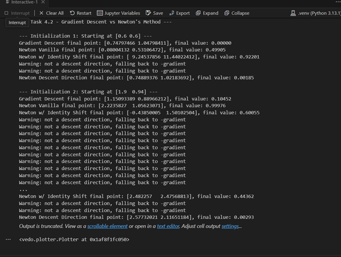

### Task 5: Numerical derivatives
Task 5.1 – Analytical Gradient and Hessian
In this task, I implemented analytical expressions for the gradient and Hessian of the objective functions, as an alternative to the slower numerical finite-difference method.

While the numerical approach is generic and easy to apply, it is computationally expensive and less precise. Deriving and implementing the derivatives manually leads to significantly faster and more stable optimization.

✅ Analytical Gradient Function
python
Copy
Edit
def analytical_gradient(X):
    x, y = X[0], X[1]

    if current_function == wavy_sine_cosine:
        df_dx = 2 * y * np.cos(2 * x * y) * np.cos(3 * y) / 2
        df_dy = (2 * x * np.cos(2 * x * y) * np.cos(3 * y) - 
                 3 * np.sin(2 * x * y) * np.sin(3 * y)) / 2
        return np.array([df_dx, df_dy])

    elif current_function == ripple_pattern:
        df_dx = -np.sin(x) * np.sin(y)
        df_dy = np.cos(x) * np.cos(y)
        return np.array([df_dx, df_dy])

    elif current_function == gaussian_hill:
        df_dx = -2 * x * np.exp(-x**2 - y**2)
        df_dy = -2 * y * np.exp(-x**2 - y**2)
        return np.array([df_dx, df_dy])
✅ Analytical Hessian Function
python
Copy
Edit
def analytical_hessian(X):
    x, y = X[0], X[1]

    if current_function == wavy_sine_cosine:
        d2f_dx2 = -4 * y**2 * np.sin(2 * x * y) * np.cos(3 * y) / 2
        d2f_dy2 = (-4 * x**2 * np.sin(2 * x * y) * np.cos(3 * y) -
                   9 * np.sin(2 * x * y) * np.cos(3 * y) -
                   6 * x * np.cos(2 * x * y) * np.sin(3 * y)) / 2
        d2f_dxdy = (2 * np.cos(2 * x * y) * np.cos(3 * y) -
                    6 * y * np.sin(2 * x * y) * np.sin(3 * y)) / 2
        return np.array([[d2f_dx2, d2f_dxdy],
                         [d2f_dxdy, d2f_dy2]])

    elif current_function == ripple_pattern:
        d2f_dx2 = -np.cos(x) * np.sin(y)
        d2f_dy2 = -np.cos(x) * np.sin(y)
        d2f_dxdy = -np.sin(x) * np.cos(y)
        return np.array([[d2f_dx2, d2f_dxdy],
                         [d2f_dxdy, d2f_dy2]])

    elif current_function == gaussian_hill:
        e = np.exp(-x**2 - y**2)
        d2f_dx2 = e * (4 * x**2 - 2)
        d2f_dy2 = e * (4 * y**2 - 2)
        d2f_dxdy = 4 * x * y * e
        return np.array([[d2f_dx2, d2f_dxdy],
                         [d2f_dxdy, d2f_dy2]])
🧠 Insight
These derivatives were obtained using symbolic differentiation of the formulas.

Having analytical forms greatly improves the efficiency and accuracy of the optimization methods, particularly Newton’s method which depends on the Hessian matrix.

This change sets the stage for advanced comparison tasks in Task 5.2, where performance is tested numerically.

Task 5.1 – Comparing Analytical vs. Numerical Derivatives
🎯 Goal:
Measure and compare the execution time of numerical vs. analytical gradient and Hessian calculations.

🧪 Method:

Used Python’s timeit module to benchmark each method over 10,000 iterations.

The comparison was based on the objective function: wavy_sine_cosine.

The evaluation point used for all tests: [0.6, 0.6].

⏱️ Timing Results:
Method                    	Gradient (sec)    	Hessian (sec)
Numerical (finite diff)	    0.17131            	0.42265
Analytical (closed-form)  	0.11043           	0.27573

📌 Conclusion:
The analytical gradient and Hessian functions are significantly faster than their numerical counterparts.
This makes them better suited for real-time optimization and repeated evaluations inside iterative algorithms like gradient descent or Newton's method.

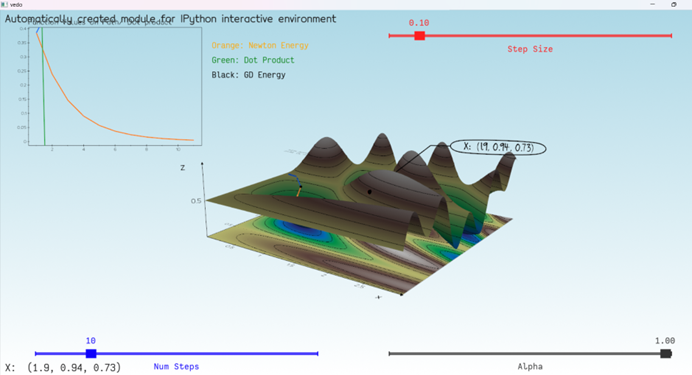
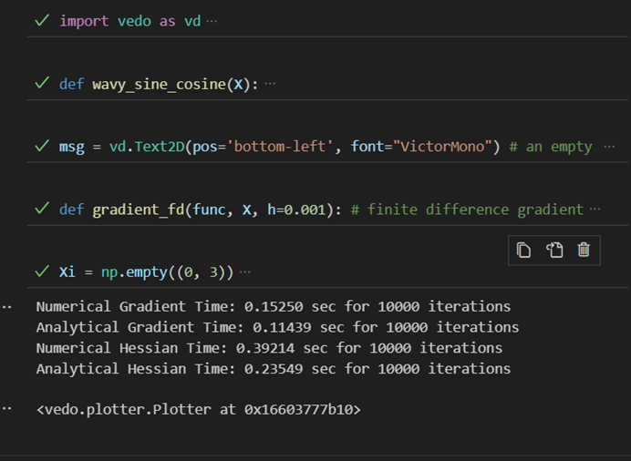

📝 Task 5.3 – Gradient Comparison for Different Epsilon Values
To test how the finite difference approximation depends on the epsilon value, I compared the gradient computed with gradient_fd to the true gradient from my analytical_gradient function. I tested five different epsilon values: 0.1, 0.01, 0.001, 0.0001, and 0.00001. The experiment was done on the current function wavy_sine_cosine, and I used three different points: (0.6, 0.6), (1.2, -0.8), and (0.0, 1.5).

At large ε = 0.1, the finite difference gradient had a noticeable error compared to the true gradient. As ε got smaller, the results became more accurate. Starting from ε = 0.001, the values were almost exactly the same as the analytical ones. There was no instability at very small epsilon (like 0.00001), which means the function is numerically stable at those points.

This shows that the choice of epsilon is important — too large causes approximation error, and too small may cause round-off problems (although not in this case). The most accurate and stable results were around ε = 0.001.

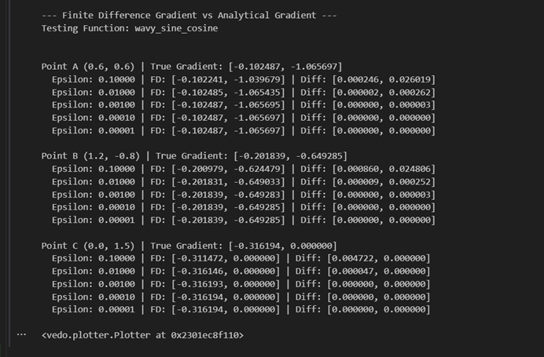

---